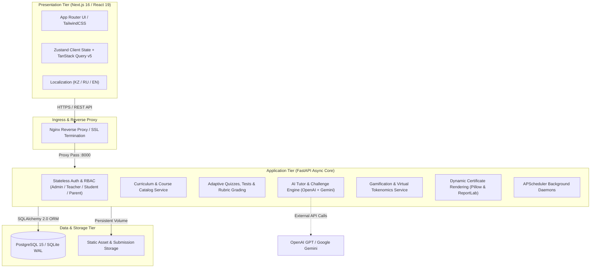

# LMS Platform (Enterprise Learning Management & EdTech System)

> **Enterprise-grade, full-stack Learning Management Platform architected with an asynchronous high-throughput FastAPI core, Next.js App Router hybrid SSR/CSR presentation layer, fine-grained RBAC authorization, contextual AI pedagogical tutoring copilot, and multi-tenant telemetry.**

[](https://www.python.org/)
[](https://fastapi.tiangolo.com/)
[](https://nextjs.org/)
[](https://react.dev/)
[](https://www.typescriptlang.org/)
[](https://www.postgresql.org/)
[](https://www.docker.com/)

---

## Pitch & Executive Summary

**LMS Platform** is a scalable, modular educational ecosystem designed to bridge curriculum delivery, real-time assessment, and student engagement at enterprise scale. Built from the ground up on modern domain-driven principles, the platform combines a high-performance **FastAPI (ASGI)** services layer with a modern **Next.js 16 (React 19)** frontend, providing sub-millisecond route transitions, interactive coursework, adaptive quizzes, gamification tokenomics, and an integrated multi-model LLM tutor (OpenAI GPT & Google Gemini).

The system supports both zero-configuration edge deployments (SQLite with Write-Ahead Logging) and enterprise multi-tenant clustering (PostgreSQL 15), containerized via Docker Compose and safeguarded by stateless JWT token lifecycles with four-tier Role-Based Access Control (RBAC).

---

## Architecture Overview

The platform is designed around loosely coupled domain boundaries, separating client-side state synchronization, edge gateway routing, core business workflows, and asynchronous background pipelines:



### Architectural Highlights

- **Decoupled Monolith with Modular Routing:** APIs are segmented into explicit domain routers (`auth`, `courses`, `assignments`, `tests`, `ai_bot`, `analytics`, `payments`, `teacher`, `parent`, `admin`) to ensure low coupling and high cohesion.
- **Dual-Engine Persistence Strategy:** Built on **SQLAlchemy 2.0**, the data access layer seamlessly toggles between local zero-dependency SQLite storage (with WAL mode enabled) and high-concurrency enterprise **PostgreSQL 15** instances without application-layer code modifications.
- **Multi-Tenant Role-Based Access Control (RBAC):** Strict hierarchical authorization enforcing distinct scopes and permissions across **Administrator**, **Teacher / Instructor**, **Student**, and **Parent** personas.
- **Asynchronous Pedagogical Copilot:** Non-blocking LLM integration orchestrating student prompt contextualization, automated code evaluation, hint generation, and synthetic quiz generation.
- **Event-Driven Background Processing:** Built-in task scheduling (**APScheduler**) handling recurring daily leaderboard calculations, learning streaks, deadline notifications, and cleanup routines.

---

## Key Enterprise Features

### 1. Fine-Grained Role-Based Access Control (RBAC) & Stateless Security
- Strict multi-tier authorization with stateless **JWT tokens** (`python-jose`) and **bcrypt** password hashing (`passlib`).
- Role-specific dashboard views and API route guards protecting sensitive student grading, parental oversight, teacher group management, and global administrative actions.
- Rate-limiting protection via `slowapi` on sensitive authentication and payment-related endpoints.
- Strict payload sanitization and typed request/response contracts using **Pydantic v2**.

### 2. Comprehensive Curriculum & Examination Pipeline
- Hierarchical course structure: **Course $\rightarrow$ Modules $\rightarrow$ Topics $\rightarrow$ Interactive Lessons / Video Lectures $\rightarrow$ Tests & Assignments**.
- Rubric-based assignment grading system enabling teachers to evaluate homework submissions with detailed criteria, private notes, and interactive class discussions.
- Dynamic test engine supporting randomized question pools, automated scoring, timed sessions, and anti-cheating state tracking.

### 3. Integrated Multi-LLM Pedagogical Copilot
- Context-aware AI assistant leveraging **OpenAI (GPT-4o)** and **Google Gemini** for instant homework help, doubt clearing, and code explanations.
- Interactive AI coding challenge modules with automated test validation and difficulty progression.
- Guardrails preventing direct solution leaks, guiding students using the Socratic dialogue method.

### 4. Gamification, Virtual Tokenomics & Digital Shop
- Engagement loop powered by activity-based virtual coins, learning streaks, daily bonus rewards, and competitive leaderboards.
- In-platform marketplace enabling students to exchange earned coins for course upgrades, custom avatars, and learning merchandise.
- Real-time progress telemetry and interactive analytics charts powered by **Recharts**.

### 5. Cryptographically Verifiable Dynamic Certificates
- Automated generation of completion certificates using server-side 2D vector/raster graphics pipelines (**Pillow** and **ReportLab**).
- Dynamic issuance timestamping, candidate identity binding, and unique verification tokens allowing third-party credential verification.

### 6. Production-Ready Multi-Container Orchestration
- Complete **Docker Compose** infrastructure defining isolated networks, persistent named volumes for databases and media uploads, and environment variable separation.
- Ready-to-deploy **Nginx** reverse proxy profiles with SSL/TLS termination and Gzip/Brotli compression.

---

## Tech Stack & Architectural Rationale

| Layer | Technology | Architectural Rationale |
| :--- | :--- | :--- |
| **Backend Framework** | **FastAPI 0.104+** | Asynchronous ASGI runtime delivers maximum I/O throughput for concurrent student requests; native Pydantic integration guarantees end-to-end type safety and self-documenting OpenAPI 3.1 schemas. |
| **Frontend Framework** | **Next.js 16 (React 19)** | Hybrid SSR/CSR architecture provides instantaneous client-side navigation, fast First Contentful Paint (FCP), and optimal caching for educational materials. |
| **Type Safety** | **TypeScript 5 & Pydantic v2** | Eliminates runtime type errors across both client and server domains, creating reliable contracts between API endpoints and UI state. |
| **Database & ORM** | **PostgreSQL 15 / SQLAlchemy 2.0** | Enterprise relational database providing ACID transactions, indexing, and foreign key integrity; abstracted by SQLAlchemy for smooth migrations between SQLite and PostgreSQL. |
| **Client State & Cache**| **TanStack Query v5 & Zustand** | High-performance server-state synchronization with automatic background refetching and atomic client-side state management. |
| **Styling & UI Components**| **TailwindCSS v4 & Lucide Icons** | Utility-first responsive design system featuring dark/light mode theming and accessible UI primitives. |
| **AI Orchestration** | **OpenAI SDK & Google Generative AI** | Multi-vendor LLM fallback providing robust contextual tutoring, query summarization, and automated test question generation. |
| **Document Rendering** | **Pillow & ReportLab** | Headless server-side rendering pipeline producing high-resolution, print-ready PDF and PNG certificate artifacts. |
| **Job Scheduling** | **APScheduler** | In-process cron scheduling for streak updates, leaderboard recalculation, and notification dispatching without requiring heavy external brokers. |
| **Deployment** | **Docker Compose & Nginx** | Hermetic, reproducible deployment architecture ensuring environment parity across development, staging, and production VPS hosts. |

---

## Repository Structure

```text
├── backend/
│   ├── app/
│   │   ├── api/routes/          # Domain-specific REST controllers (auth, courses, ai, etc.)
│   │   ├── core/                # Core configuration, security settings, database sessions
│   │   ├── models/              # SQLAlchemy 2.0 ORM entity definitions
│   │   ├── schemas/             # Pydantic v2 request/response DTO schemas
│   │   ├── services/            # Business logic: AI tutor, certificates, leaderboards
│   │   ├── jobs/                # Scheduled background daemons
│   │   └── main.py              # Application entrypoint & middleware configuration
│   ├── scripts/                 # Schema migrations, data seeders & administrative tools
│   ├── uploads/                 # Storage for media assets, avatars and course fixtures
│   ├── Dockerfile               # Multi-stage Python 3.12 production container build
│   └── requirements.txt         # Pinned backend dependencies
├── frontend-next/
│   ├── src/
│   │   ├── app/                 # Next.js 16 App Router (routes, layouts, pages)
│   │   ├── components/          # Reusable UI component library (courses, tests, shop, ui)
│   │   ├── hooks/               # Custom React hooks (auth, query caching, telemetry)
│   │   ├── lib/                 # HTTP client instances (Axios), utilities
│   │   ├── store/               # Zustand client store slices
│   │   └── types/               # TypeScript domain interfaces and API models
│   ├── public/                  # Static assets and icons
│   ├── package.json             # Frontend dependencies & build scripts
│   └── tsconfig.json            # Strict TypeScript configuration
├── deploy/                      # Infrastructure assets: Nginx configuration, backup scripts
├── docker-compose.yml           # Production multi-service orchestration (Postgres, API, Web)
├── start.sh                     # Unified local development bootstrap script (Linux/macOS)
├── start-windows.bat            # Unified local development bootstrap script (Windows)
└── README.md                    # Project documentation
```

---

## Getting Started

### Prerequisites

- **Docker & Docker Compose** (Recommended for full-stack run)
  *— or —*
- **Python 3.12+** and **Node.js 20.9+** (For native bare-metal development)

---

### Option A: Quickstart via Docker Compose (Recommended)

1. **Clone repository:**
   ```bash
   git clone https://github.com/NURJAKS/lms-qit.git
   cd lms-qit
   ```

2. **Configure environment:**
   ```bash
   cp backend/.env.example backend/.env
   # Edit backend/.env to provide your optional OpenAI/Gemini API keys and secret key
   ```

3. **Launch all services:**
   ```bash
   docker compose up -d --build
   ```

4. **Access the application:**
   - **Frontend Application:** [http://localhost:3000](http://localhost:3000)
   - **Backend API & Swagger Docs:** [http://localhost:8000/docs](http://localhost:8000/docs)
   - **OpenAPI JSON Spec:** [http://localhost:8000/openapi.json](http://localhost:8000/openapi.json)

---

### Option B: Bare-Metal Development Mode

Run the unified bootstrap script which configures Python virtual environment, installs dependencies, and boots both frontend and backend concurrently:

```bash
# On Linux / macOS:
chmod +x start.sh
./start.sh

# On Windows:
start-windows.bat
```

---

## Verification & Health Check

| Service | Target URL | Expected Output |
| :--- | :--- | :--- |
| **API Health / Docs** | `http://localhost:8000/docs` | Interactive Swagger UI with all 20+ endpoint routers |
| **Course Catalog** | `http://localhost:3000/courses` | SSR Course Catalog with categories and filters |
| **Interactive Tutor** | `http://localhost:3000/app/ai-tutor` | Real-time AI chat interface with streaming responses |

---

## Known Limitations & Production Roadmap

- **External Message Broker:** While `APScheduler` handles background tasks efficiently within a single container, high-scale multi-replica setups will benefit from migrating to a distributed task queue (e.g., Celery / Redis Streams).
- **Object Storage Migration:** Currently, uploaded materials and certificates reside on persistent Docker volumes. The roadmap includes an S3/MinIO driver integration for zero-downtime distributed storage.
- **WebSocket Gateway:** Real-time chat and notifications currently utilize polled REST endpoints; migration to an asynchronous WebSocket gateway is planned for immediate push alerts.

---

## License

This project is licensed under the MIT License — see the LICENSE file for details.
